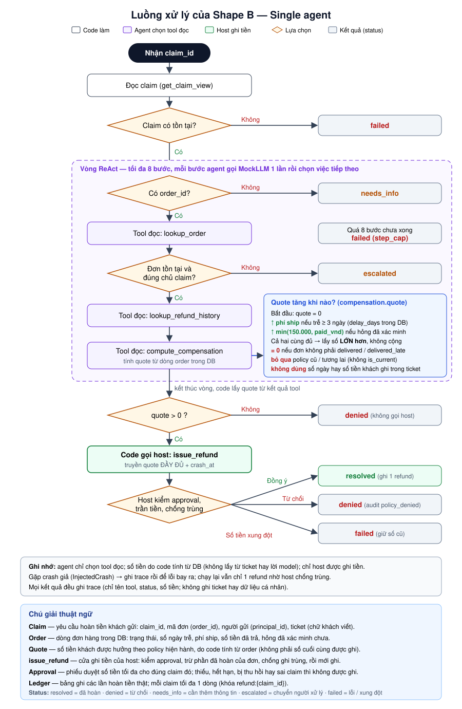

# Báo cáo cá nhân — 2A202603993_CaoTrungHieu

## 1. Thông tin thành viên

- Họ tên: Cao Trung Hiếu
- MSSV: 2A202603993
- Email: 26ai.hieuct@vinuni.edu.vn
- GitHub: HieuCaoTlu

## 2. Phần việc phụ trách

- Shape B Single — ReAct agent, có check crash: [src/lab8/shapes/single.py](../../src/lab8/shapes/single.py) (xử lý crash tại [single.py:199-204](../../src/lab8/shapes/single.py#L199-L204))
- Làm phần test riêng cho Single agent: [src/tests/test_single_shape.py](../../src/tests/test_single_shape.py)
- Mô tả sơ đồ luồng Single: [images/single_money_flow.svg](images/single_money_flow.svg); làm demo tương tác: [demo/single_agent_chat.html](demo/single_agent_chat.html)

## 3. Đóng góp cụ thể

**Commit chính:** [`b1ee347`](https://github.com/phuthaitran/K5-L3B-DAY8-AIDoCode-FromWorkflowsToAgents/commit/b1ee34727fb5891df03fda2eff18226bf6bffc71) — `feat: add single agent demo generation script and HTML template` (nhánh `CaoTrungHieu`, merge vào `main` qua PR #2). Gồm `single.py`, `test_single_shape.py`, sơ đồ, demo và script sinh demo.

**Test đã thêm** (`src/tests/test_single_shape.py`, 3 test):

| Test | Kiểm tra | Số ca | Kết quả |
| --- | --- | ---: | ---: |
| `test_single_trace_has_no_ticket_secret_or_pii` | Chạy cả 14 claim public: trace đúng `run_id`, không chứa ticket, `CANARY_SECRET`, SĐT, địa chỉ, ghi chú nội bộ, tên hàng | 14 claim | 14/14 pass |
| `test_single_ignores_delay_written_in_ticket` | C-002 (ticket ghi trễ 5 ngày, DB chỉ 2 ngày) ở 5 seed → `denied`, quote 0, không có refund, số lần gọi model ≤ 8 | 5 seed | 5/5 pass |
| `test_single_fails_closed_when_agent_skips_quote` | Giả lập agent kết thúc mà không gọi `compute_compensation` → `denied`, quote 0, ledger không có refund | 1 ca | 1/1 pass |

Chạy `python -m pytest -v tests/test_single_shape.py` (trong `src/`) → **3 passed in 0.58s**.

Quyết định kỹ thuật:

- Agent chỉ chọn tool đọc; số tiền lấy từ `compute_compensation`, không lấy từ model hay ticket.
- Truyền quote đầy đủ cho host, không tự trừ phần đã hoàn (T14: quote 150.000, host ghi 120.000).
- Agent không tính quote → quote = 0 → `denied`, không gọi host (fail-closed).
- Idempotency do host lo (khóa `refund:{claim_id}`); shape truyền `crash_at`, không bắt `InjectedCrash`, không tự ghi checkpoint. Chạy lại → `idempotent_replay`, vẫn 1 refund (T11, T12).
- Trace chỉ ghi tên tool, status, quote, lý do; không ghi ticket hay order row.

## 4. Bằng chứng

| Lệnh (trong `src/`) | Kết quả |
| --- | --- |
| `python -m pytest -q -m student -o addopts= -k "single and not workflow and not orchestrator and not swarm"` | **62 passed** (T01–T14) |
| `python -m pytest -q tests/test_single_shape.py` | **3 passed** |

Benchmark thử (14 claim public × 5 seed):

| Shape | Pass rate | pass^5 | Variance | Cost/success |
| --- | ---: | ---: | ---: | ---: |
| single | 1.000 | 1.000 | 0.000 | 45.20 |
| swarm | 0.986 | 0.929 | 0.0008 | 49.57 |

## 5. Công cụ AI đã dùng

| Công cụ | Dùng vào việc gì | Cách tự kiểm tra |
| --- | --- | --- |
| Claude Code | Tóm tắt đề, hỗ trợ code và test shape single, vẽ sơ đồ, làm demo | Chạy lại test (62/62, 3/3), đọc trace kiểm không lộ secret/PII, đối chiếu `docs/contracts.md` |

## 6. Tự đánh giá

- Làm được: shape single qua 62/62 test student, 3 test riêng, pass rate 1.000 / variance 0 trên public; sơ đồ + demo giải thích luồng.
- Giới hạn: decide() hiện là luật cố định, MockLLM chỉ để tính cost -> số liệu chưa phản ánh model thật hay quên bước; chưa chạy trên bộ hidden; chưa so với workflow/orchestrator vì hai shape đó chưa xong.
- Học được: một kiến trúc agent đơn giản nhưng cũng đủ để hoàn thành sơ bộ chức năng hoàn tiền, biết được trade-off khi lựa chọn các kiến trúc
- Điều làm tốt: hiểu được kiến trúc agent một cách cụ thể
- Điều chưa làm được / giới hạn: chưa thể code tay hoàn toàn
